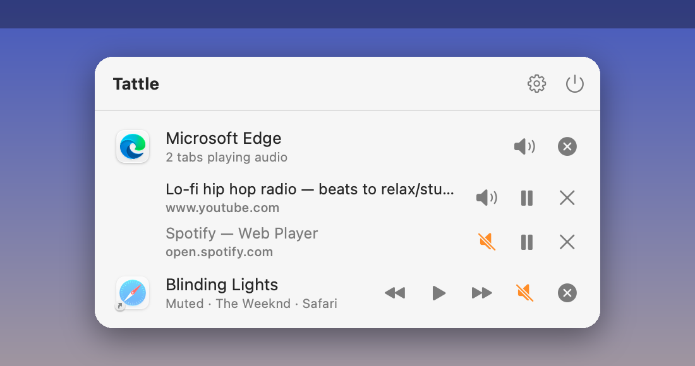

<p align="center"></p>

<h1 align="center">Tattle</h1>

<p align="center">
  Tells you which app, and which browser tab, is making noise on your Mac,<br>
  and lets you mute, pause, skip, close or quit it from the menu bar.
</p>

<p align="center">
  <a href="https://github.com/hieudvu/tattle/releases/latest"></a>
</p>

<p align="center">
  <a href="https://github.com/hieudvu/tattle/releases/latest"></a>
  <a href="https://github.com/hieudvu/tattle/releases"></a>
  
  <a href="LICENSE"></a>
</p>

<p align="center"></p>

## What it does

- **Finds the noise.** Every app currently playing audio, live. Helper processes collapse into their
  app, and `--headless` browsers are flagged.
- **Down to the tab.** With the browser extension (Chrome, Edge, Brave, Arc, Vivaldi, Opera, Firefox
  and Safari) each noisy tab is listed by title and site.
- **Controls where it counts.** Mute or unmute an app or a single tab, pause, previous / next track,
  close a tab, or quit the app.
- **Now Playing.** Shows the song or video title next to the app.
- **Light on resources.** It only scans while the panel or Settings is open.
- **Private.** Everything stays on your Mac. Tab titles and URLs are read locally by the extension
  and never leave it; Tattle never records or stores audio.

## Install

Download the zip for your Mac from the [latest release](https://github.com/hieudvu/tattle/releases/latest)
(`arm64` for Apple silicon, `x86_64` for Intel), unzip, and drag Tattle to Applications. It is signed,
notarized and updates itself. Requires macOS 15+.

Tab-level control needs the browser extension: open Settings ▸ Browsers and follow the steps for your
browser. Chrome and Edge load it unpacked (`tattle-chromium.zip` in the release); Safari's is built in.

## Develop

```bash
make d      # build + (re)launch "Tattle Dev.app" (bundle id dev.hieuvd.tattle.dev)
make p      # build "Tattle.app" (bundle id dev.hieuvd.tattle) (no dev suffix, verified)
make test   # swift test (all mocks; never touches the host)
```

Requires macOS 15+.

## Releasing

1. Move the `[Unreleased]` entries in `CHANGELOG.md` under a new `## [x.y.z] - YYYY-MM-DD` heading.
2. `git tag vx.y.z && git push origin vx.y.z`.

`.github/workflows/release.yml` then tests, builds arm64 (`macos-26`) and Intel (`macos-26-intel`),
signs with Developer ID, notarizes, and publishes a GitHub Release with
`Tattle-<ver>-arm64.zip`, `Tattle-<ver>-x86_64.zip`, `tattle-chromium.zip`, `tattle-firefox.zip` and
the Sparkle feeds `appcast-arm64.xml` / `appcast-x86_64.xml`. The changelog section is the release notes
in both GitHub and the in-app update window; the run fails early if the section is missing.
A manual run (`workflow_dispatch`) builds and uploads artifacts only.

Repo secrets: `MACOS_CERT_P12_BASE64`, `MACOS_CERT_PASSWORD`, `APPLE_ID`, `APPLE_APP_PASSWORD`,
`APPLE_TEAM_ID`, `SPARKLE_PRIVATE_KEY` (EdDSA key, `generate_keys -x file`; its public half is
`SUPublicEDKey` in `scripts/bundle.sh`).

## Updates

Pro builds update themselves with [Sparkle](https://sparkle-project.org) (Settings ▸ About ▸ Check for
Updates, plus an automatic-check switch). Each build reads its own architecture's feed from
`https://github.com/hieudvu/tattle/releases/latest/download/appcast-<arch>.xml`. Dev builds carry no feed
and never update. Sparkle compares `CFBundleVersion` (set from the workflow run number, so it only goes up).

## Icons

- macOS 26/27: `Resources/Tattle.icon` (Icon Composer, Liquid Glass), compiled to
  `Assets.car` by `actool` in `scripts/bundle.sh` and picked via `CFBundleIconName`.
- macOS 15: `Resources/Legacy.icns`, generated by `scripts/make-icon.sh` from
  `design/icons/app-icon.svg` and picked via `CFBundleIconFile`.
- Both use the same whistle; the committed `.icns` means builds don't need a browser.

## Layout

- `TattleCore`: pure logic behind three protocols (audio source, process
  inspector, terminator). No system calls.
- `TattleSystem`: the real implementations (Core Audio HAL, sysctl, `kill`).
- `TattleApp`: SwiftUI menu bar UI.

Tests link `TattleCore` only, so they use fakes and can never touch the host.

## Browser extensions (tab-level mute / pause / close)

`Extensions/` holds one shared JS core plus thin Chromium (Chrome, Edge, Brave, Arc, …),
Firefox and Safari wrappers; see `Extensions/README.md` and `docs/extension-protocol.md`.
`node scripts/build-extensions.mjs` builds Chromium/Firefox; Safari is an `.appex` that
`scripts/bundle.sh` adds to every bundle. Install the native-messaging
host per browser from Settings ▸ Browsers.

Don't loop on `make d`: every launch re-registers the app with macOS.
